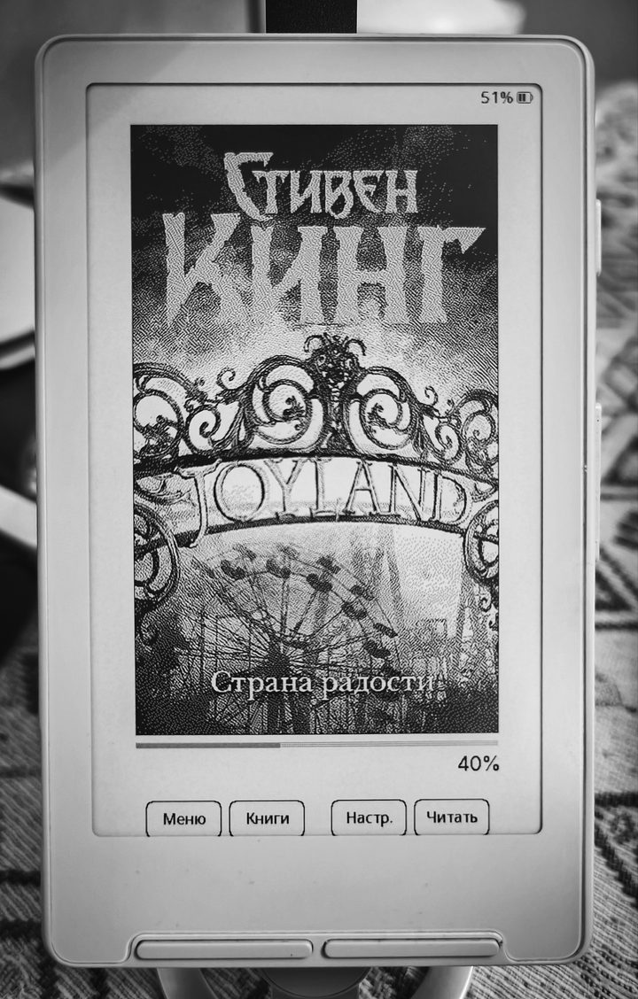
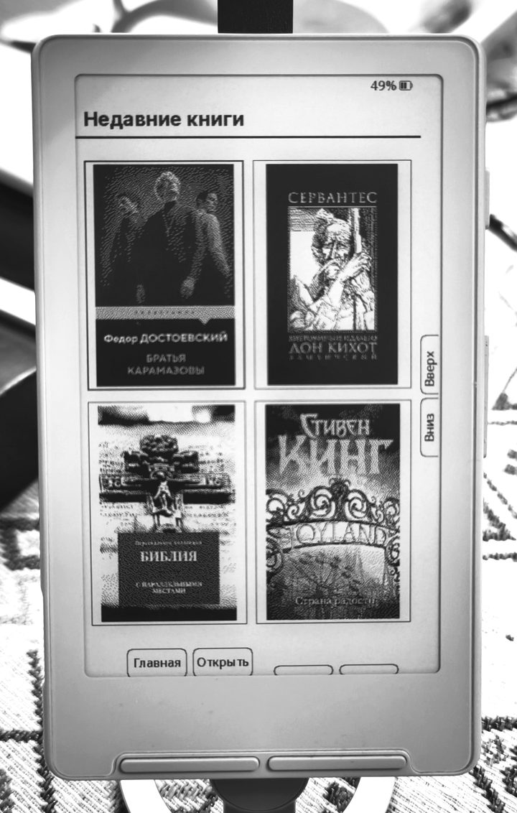
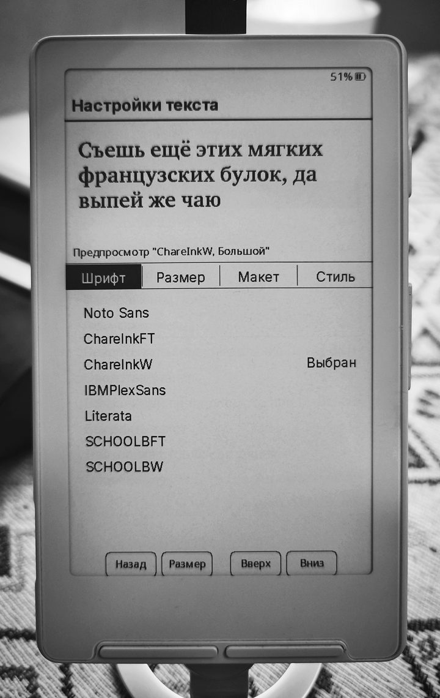
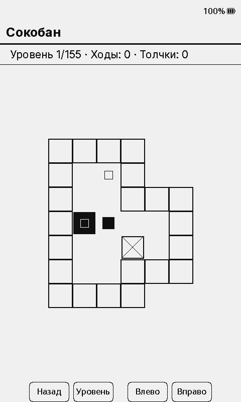
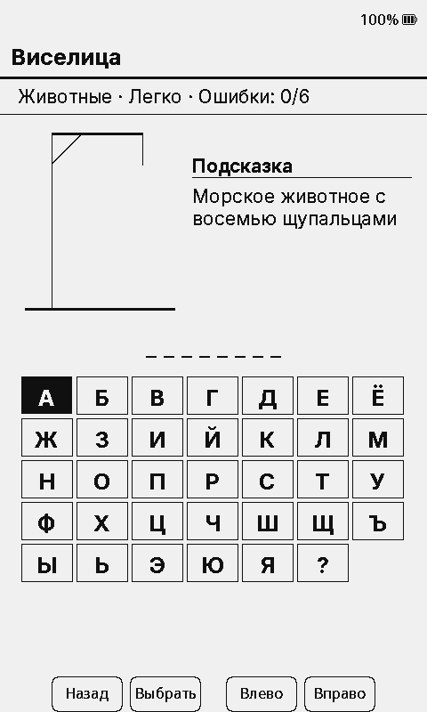

<div align="center">
  <picture>
    <source media="(prefers-color-scheme: dark)" srcset="assets/paperio-reader-header-dark.svg">
    <source media="(prefers-color-scheme: light)" srcset="assets/paperio-reader-header.svg">
    
  </picture>
</div>

<p align="center">
  
  
  
  
</p>

<details open>
<summary><h2>Возможности прошивки</h2></summary>


Прошивка для электронных книг **XTEINK X3 и X4**.

Стабильная версия: **Paperio Reader 2.2.5**.

Тестовая версия: **[Paperio Reader 2.2.6-rc.5](https://github.com/Kapfilm/Paperio-Reader/releases/tag/2.2.6-rc.5)** для X3 и X4. Для обновления по воздуху включите бета-обновления; стабильный канал остаётся на 2.2.5.

Важные изменения тестовой ветки 2.2.6:

- **Компактные заголовки FB2 и EPUB.** Заголовки FB2 уменьшены ещё на одну ступень; EPUB использует такую же шкалу: H1 — 115%, H2 — 108%, H3–H6 — 100% основного текста. Крупный размер из стилей EPUB не увеличивает эти заголовки.
- **[Dropbox: загрузка книг из папок](docs/dropbox.md).** Поддержаны вложенные папки, возврат к родительской и постраничный просмотр. Ридер только читает облако и скачивает книги на SD; папки в Dropbox создаются с телефона или компьютера. Прогресс и заметки не синхронизируются. Для подключения нужен публичный App key собственного приложения Dropbox; инструкция создания и подключения приведена по ссылке.
- **Быстрый доступ и удобный список Dropbox.** Пункт со значком находится в «Меню» перед OPDS. Значок имеет правильную ориентацию и прозрачный фон. Папки обозначены значками, строки имеют одинаковую компактную высоту, формат книги всегда виден в колонке справа. Служебные строки обновления списка и настройки убраны; изменение подключения доступно в веб-интерфейсе через «Меню → Передача файлов».
- **[Встроенные примечания в FB2, FB2.ZIP и EPUB](docs/inline-footnote-previews.md).** Исправлен сбор текста FB2 и старых якорей EPUB. В rc.5 восстановлен обычный размер шрифта примечаний; убраны прежние ограничения в 240 байт и несколько строк. Длинный текст читается с SD частями. Исходный номер ссылки сохраняется, повторный номер в тексте примечания удаляется при уверенном совпадении.
- **Кэш без потери прогресса.** Ошибки чтения и отмена не сохраняются как успешный пустой результат. Старый кэш примечаний и страницы с включёнными примечаниями перестраиваются автоматически. Книги, прогресс, закладки и выделения сохраняются.
- **Сетевая память.** Снижены лишние выделения памяти при просмотре папок Dropbox, отключена периодическая перерисовка во время сетевого сеанса. В rc.5 ответы обрабатываются небольшими проверяемыми блоками, сетевое соединение закрывается до разбора ответа; большой непрерывный буфер больше не требуется. Поведение X3 после обновления нужно подтвердить на самом устройстве.

[Изменения rc.5 и установка](docs/releases/2.2.6-rc.5.md).

- Поддержка EPUB, FB2, FB2.ZIP, TXT, XTC/XTC-H и Markdown.
- Замена обложки книги EPUB или FB2 изображением JPG, JPEG, PNG или BMP с SD-карты и возврат к встроенной обложке в любой момент.
- Быстрая отрисовка, фоновая индексация и бережная предзагрузка следующего изображения.
- Сноски, оглавление, переходы по ссылкам и возврат к предыдущему месту чтения.
- Поддержка CSS и таблиц EPUB, обтекания изображений, переносов слов, надстрочного и подстрочного текста.
- Пользовательские шрифты и единый экран настроек текста с предварительным просмотром. Размер шрифта можно выбирать по названию или числом; числовой режим доступен и в настройках отдельной книги.
- Межстрочный интервал от 70% до 200% с шагом 1%: общая настройка в «Настройках текста» и настройка для отдельной книги в «Быстрых настройках» и «Переопределениях для книги».
- Тёмная тема на X3 и X4: только при чтении или во всём интерфейсе; обложки и иллюстрации сохраняют исходную полярность.
- Непрерывная вёрстка исходных глав FB2: длинные главы не делятся на технические фрагменты, оставляющие пустое место внизу страницы, а счётчик страниц охватывает всю главу.
- Темы Mini и Lyra; отображение недавних книг и библиотеки сеткой обложек 2×2.
- Закладки, именованные страницы, выделения и общий список закладок всех книг.
- Статистика чтения, часы, погода и синхронизация с KOReader.
- Игры без интернета: судоку, сокобан, какуро, «Виселица» и «Пятнашки» с сохранением прогресса и отдельной статистикой.
- Настраиваемые короткие, двойные и долгие нажатия кнопок, включая отдельные действия загрузки и отправки прогресса KOReader.
- Обычный или жирный шрифт интерфейса и независимый выбор обычного или увеличенного размера на X3 и X4. Настраиваемое перелистывание наклоном на X3.
- Прозрачные заставки сна, информационный слой, случайная сохранённая цитата с указанием автора и белый фон для быстрого и полного сна.
- Wi-Fi, доступ к файлам через веб-интерфейс, передача по USB Serial, установка прошивки с SD-карты и обновления по воздуху.
- Переключение между Paperio и inkMOD во втором слоте и аварийное восстановление. Требования к установке и ограничения описаны ниже.

Обновления OTA доступны в меню `Настройки → Система → Обновление системы → Проверить обновления`.
Для ручной установки используйте [firmware.bin версии 2.2.5](https://github.com/Kapfilm/Paperio-Reader/releases/download/2.2.5/firmware.bin).

История изменений доступна на [странице релизов](https://github.com/Kapfilm/Paperio-Reader/releases).


</details>

<details open>
<summary><strong>Что нового в 2.2.5</strong></summary>


- **Интерфейс X3 и X4:** возвращён выбор обычного или жирного шрифта интерфейса. Увеличенный размер теперь доступен не только на X3, но и на X4; размер и жирность выбираются независимо. Отступы меню учитывают выбранный размер. Надпись «Загрузка» при запуске всегда остаётся маленькой и обычного начертания, даже при увеличенном жирном шрифте интерфейса.
- **Недавние книги:** две нижние кнопки действий видимы и работают по обычному нажатию: **Удалить** запрашивает подтверждение перед удалением записи из списка недавних, а **Инфо** открывает сведения о книге. Удаление записи не удаляет файл книги с SD-карты. Все четыре нижние подписи используют одинаковый исходный размер шрифта выбранной темы; длинные слова сокращаются вместо уменьшения отдельных подписей.
- **Навигация в недавних книгах:** боковые кнопки **Вверх/Вниз** последовательно перебирают все книги в списке и сетке, включая каждый столбец. **Удержание Вверх** переключает список и сетку. Центрированная подсказка заменяет старые обозначения `+L` и всегда остаётся маленькой на обоих устройствах независимо от размера и жирности интерфейса.
- **Заставка «Цитата»:** `Настройки → Экран → Экран сна → Цитата` выбирает случайное сохранённое выделение из всех книг. Межстрочный интервал уменьшен; под текстом указан только автор без названия книги. Удалённые выделения, резервные копии, файлы экспорта и повреждённые файлы выделений не участвуют в выборе. Если подходящих выделений нет, показывается стандартная заставка сна. Быстрое возобновление при срабатывании таймера, если оно включено, сохраняет прежний приоритет.
- **Назначения кнопки питания:** долгому нажатию питания теперь можно назначить те же функции, что и другим кнопкам. При выборе функции, отличной от сна, появляется напоминание назначить сон на другую кнопку или тип нажатия; выбор не блокируется. Короткое нажатие питания по умолчанию переводит устройство в сон; для долгого нажатия сон также остаётся действием по умолчанию. Явные пользовательские назначения и действие «Игнорировать» сохраняются.
- **Независимый способ пробуждения:** `Настройки → Управление → Кнопка питания → Пробуждение` позволяет выбрать короткое или долгое нажатие; по умолчанию используется короткое. Настройка не зависит от заставки сна и назначений кнопок; быстрое возобновление не обходит выбранное долгое пробуждение. Настройки запуска доступны до подключения SD-карты. Удерживаемое нажатие пробуждения по-прежнему подавляется, чтобы сразу не выполнить другую команду; сочетания для снимка экрана и восстановления остаются доступны, а одно лишь подключение USB не считается подтверждённым пробуждением кнопкой питания.
- **Обработка сна и пробуждения X3:** реальное нажатие для пробуждения фиксируется до загрузки настроек запуска, поэтому кнопку не требуется удерживать на протяжении их чтения. Команды сна имеют приоритет над необязательной настройкой измерителя заряда; эта настройка откладывается на время определения типа нажатия питания. Обязательное завершение уже начатой настройки измерителя сохраняется и выполняется на обычной частоте процессора. Изменения устраняют лишние программные задержки; загрузчик и более медленная форма обновления экрана X3 по-прежнему требуют времени. Короткое нажатие при холодном запуске X3, отпущенное до того, как приложение успело его увидеть, нельзя надёжно отличить от включения по USB. Фактическое время на устройствах не измерялось.
- **Обложки progressive JPEG:** небольшие прогрессивные JPEG теперь восстанавливаются с полной детализацией яркости вместо грубого блочного предпросмотра. Исправлены обложки, которые выглядели размытыми, хотя исходное изображение содержало различимые детали. Полное декодирование ограничено изображениями до **512×768** и **4096 блоков с учётом дополнения краёв**; для более крупных или неподдерживаемых случаев либо при нехватке памяти в начале работы сохраняется прежний режим предпросмотра. Прошивка не может восстановить детали, отсутствующие в исходном изображении.
- **Обновление кэша обложек:** старые отрисованные обложки и миниатюры автоматически создаются заново при обращении к ним. Исходные изображения, прогресс чтения, закладки, выделения, статистика и индексы книг сохраняются; при обновлении с 2.2.4 или сборок `2.2.4-ui-quotes-cover-test` вручную удалять кэш или сбрасывать настройки не требуется.

Тестовая основа, собранная на GitHub, прошла **668 проверок**; **3 необязательные проверки с внешней книгой пропущены**. Также проверены **32 сочетания настроек интерфейса с реальными шрифтами**. Готовый образ прошивки проверен на формат ESP32-C3, контрольную сумму и целостность SHA-256. Реализация progressive JPEG дополнительно прошла 18 тестов декодера и кэша с AddressSanitizer и UndefinedBehaviorSanitizer. Программные проверки не заменяют проверку внешнего вида экрана и времени сна и пробуждения на физических устройствах.


</details>

<details>
<summary><strong>Чтение FB2</strong></summary>


Скопируйте книгу `.fb2` или `.fb2.zip` на SD-карту и откройте её из библиотеки.
Обычный `.zip` с файлом FB2 также распознаётся. Если в архиве несколько файлов
FB2, открывается первый найденный; для отдельных книг используйте отдельные
архивы.

<details>
<summary>Поддерживаемые возможности</summary>


- Название, автор, аннотация, заголовки и вложенные разделы. Оглавление использует названия глав из книги; раздел без заголовка может отображаться с автоматически созданной подписью.
- Встроенные обложки и иллюстрации. Обложка доступна на главном экране и в библиотеке, если она есть в книге и её изображение удаётся прочитать.
- Основное оформление текста: абзацы, жирное и курсивное выделение, цитаты, эпиграфы, стихи, надстрочный и подстрочный текст.
- Сноски, ссылки между разделами и ссылки на отдельные элементы текста, включая абзацы и ячейки таблиц. Это позволяет читать книги с большим количеством примечаний и перекрёстных ссылок.
- Окно примечаний, вложенные переходы, открытие полного текста и возврат к месту чтения.
- Общие настройки текста, сохранение позиции чтения, закладки и выделения.
- UTF-8, Windows-1251 и KOI8-R; для устаревших кодировок важно правильное объявление кодировки в самом файле FB2.


</details>

<details>
<summary>Первое и последующие открытия</summary>


При первом открытии прошивка подготавливает книгу и создаёт индексы на
SD-карте. Большая книга с тысячами разделов, сносок или изображений требует
больше времени, чем короткий роман; архив также нужно распаковать. На карте
должно хватать свободного места для распакованной книги и служебных файлов.

Результат подготовки сохраняется. При повторном открытии сразу используется
действующий индекс без показа экрана «Индексация». Обложки и индексы не удаляются
только из-за открытия других книг. Очистка кэша, повреждение служебных файлов
или обновление формата индекса в новой версии прошивки могут потребовать
повторной подготовки книги. Сохранение позиции чтения и закладок при смене
формата индекса зависит от версии прошивки; ниже описан переход с 2.1.6.


</details>

<details>
<summary>Обновление с 2.1.6 до 2.1.7</summary>


Ранее открытые книги FB2 один раз подготавливаются заново: технические фрагменты
заменяются исходными главами. Старая позиция переносится в **начало исходной
главы**, содержавшей сохранённый фрагмент, а не на прежнюю страницу.

Старые закладки и выделения автоматически в новую вёрстку не переносятся.
Их данные сохраняются на SD-карте в архиве кэша с суффиксом
`.before-native-chapters` и больше не отображаются как активные закладки или
выделения. Автоматического восстановления этих записей из архива через
интерфейс нет. Перед обновлением запишите важные позиции чтения. Настройки
книги сохраняются.

При обновлении с тестовых сборок `2.1.7-fb2-chapters-test1` или
`2.1.7-line-spacing-test1` дополнительный перенос не требуется.


</details>

<details>
<summary>Межстрочный интервал</summary>


`Настройки текста → Макет → Межстрочный интервал` задаёт общий интервал.
«Быстрые настройки» и `Переопределения для книги → Межстрочный интервал` задают
интервал для текущей книги; «По умолчанию» возвращает общее значение.
Настройка доступна при чтении EPUB и FB2 в диапазоне **70–200%**. Передние
кнопки меняют значение на **1%**, боковые — на **10%**. OK сохраняет выбор,
«Назад» отменяет изменение.


</details>

<details>
<summary>Ограничения</summary>


- Таблицы FB2 отображаются последовательно, ячейка за ячейкой, с сохранением текста и ссылок. Исходная сетка столбцов не воспроизводится.
- Подготовка книги и вёрстка страниц — разные операции. Смена шрифта, его размера или интервала может потребовать повторной вёрстки; пауза возможна и при открытии ещё не подготовленного фрагмента. Отсутствие дополнительного экрана индексации не отменяет эту работу.
- Первое открытие примечания может потребовать вёрстки его текста. Время открытия зависит от размера фрагмента, изображений в нём и скорости SD-карты.
- Для перехода цель ссылки должна существовать в исходном FB2. Прошивка не может восстановить повреждённые ссылки или отсутствующие изображения в самой книге.


</details>

</details>

<details>
<summary><strong>Пользовательские обложки книг</strong></summary>


Пользовательские обложки доступны для EPUB, FB2 и FB2.ZIP. Откройте сведения о
книге, нажмите **Обложка** и выберите изображение на SD-карте. Поддерживаются
JPG, JPEG, PNG и BMP. Изображение копируется рядом с книгой в служебный файл,
поэтому исходный файл книги не изменяется.

Главный экран, список недавних книг, сведения о книге и экран завершённой
книги пересоздают миниатюры сразу после смены обложки. Откройте то же меню и
выберите **Вернуть оригинальную**, чтобы удалить пользовательское
изображение и вернуться к обложке из книги.


</details>

<details>
<summary><strong>Игры</strong></summary>


Откройте **Игры** на главном экране или в меню
`Настройки → Система → Инструменты → Игры`. Все игры работают без интернета.

- **Судоку:** лёгкие, средние и сложные задачи, заметки карандашом, подсказки,
  проверка ошибок, таймер, автосохранение и статистика по уровням сложности.
- **Сокобан:** все 155 уровней встроенной игры CrossMux, выбор уровня,
  счётчики ходов и толчков, отмена хода и сохранение прогресса уровней.
- **Какуро:** лёгкие, средние и сложные числовые кроссворды, подсказки,
  проверка ошибок, таймер, сохранение прогресса и статистика.
- **Виселица:** английские и русские наборы слов по категориям, лёгкая и сложная
  игра, подсказки, сохранение, статистика побед и поражений и режим для двух
  игроков, где один вводит слово, а другой его угадывает.
- **Пятнашки:** перемешанное поле 4×4 с гарантированным решением, счётчик ходов,
  автосохранение прогресса и переключаемое управление — по пустой ячейке или
  перемещаемой плитке.

<p align="center">
  
  
  
  
  
</p>

В сокобане кнопки направлений перемещают персонажа, кнопка подтверждения
открывает выбор уровня, кнопка питания отменяет последний ход, а «Назад»
возвращает на экран игр.


</details>

<details>
<summary><strong>Примеры книг: сноски и примечания</strong></summary>


**Библия с толкованиями блаженного Феофилакта Болгарского** — пример большого
EPUB с параллельными местами, перекрёстными ссылками и **6268 толкованиями**.
Книга подходит для знакомства с окном примечаний, вложенными переходами и
возвратом к исходному стиху в Paperio Reader.

**[Скачать Библию с толкованиями Феофилакта в формате EPUB — 6,7 МБ](https://github.com/Kapfilm/Paperio-Reader/raw/refs/heads/Paperio-Reader/examples/bible-theophylact.epub)**

В EPUB сохранены крупные центрированные заголовки, отступы между заголовками
и текстом, курсивные цитаты и обратные ссылки. Внутренняя группировка страниц
оптимизирована для переходов; ускоренное открытие толкований подтверждено на
XTEINK X4 с Paperio. EPUBCheck: ошибок и предупреждений нет.

**Библия с толкованиями Иоанна Златоуста** — особенно требовательный пример
с многочисленными сносками, примечаниями и перекрёстными ссылками, подходящий
для проверки скорости обработки больших книг.

**[Скачать Библию с толкованиями Иоанна Златоуста в формате FB2.ZIP — 7,8 МБ](https://github.com/Kapfilm/Paperio-Reader/raw/refs/heads/Paperio-Reader/examples/bible-zlatoust.fb2.zip)**

Архив содержит один файл FB2 размером 32,0 МБ.

Скопируйте выбранный файл на SD-карту и откройте в Paperio Reader. Выберите
ссылку на параллельное место или номер толкования, чтобы открыть примечание;
кнопка «Назад» возвращает к месту чтения.


</details>

<details>
<summary><strong>Выделение текста</strong></summary>


В книгах доступны три стиля выделения:

- **Маркер (светло-серый)** — ненавязчивое выделение без затемнения текста.
- **Чёрный маркер** — контрастное выделение с белым текстом.
- **Подчёркивание** — сохраняет исходный фон страницы.

Выберите нужный стиль через `Меню книги → Выделить текст`; стиль по умолчанию
задаётся в настройках чтения. Выделение также можно назначить короткому,
двойному или долгому нажатию боковой кнопки.


</details>

<details>
<summary><strong>Словари</strong></summary>


Paperio Reader поддерживает словари **StarDict**. Распакуйте каждый словарь в
отдельную папку на SD-карте:

```text
/dictionaries/Dictionary name/
├── dictionary.idx
├── dictionary.dict       or dictionary.dict.dz
└── dictionary.ifo        optional
```

Файл `.idx` и выбранный файл `.dict` или `.dict.dz` в одной папке должны иметь
одинаковое базовое имя. При первом поиске прошивка автоматически создаёт
рядом быстрый индекс `.qidx`; для большого словаря это может занять время.
Если сжатый файл `.dict.dz` не открывается, используйте несжатый `.dict`.

Словарь можно выбрать через `Настройки → Чтение → Словарь` или прямо из меню
открытой книги командой `Выбрать словарь`.

При выборе **«Автоматически»** прошивка сначала ищет в наиболее подходящих
словарях с учётом алфавита запроса, а при необходимости проверяет остальные
установленные словари. Это удобно, если на карте есть, например, русский
толковый и англо-русский словари.

Чтобы найти слово, откройте меню книги, выберите `Найти в словаре`, затем
нужное слово. Это действие также можно назначить короткому, двойному или
долгому нажатию любой кнопки в настройках управления.


</details>

<details>
<summary><strong>Установка и обновления</strong></summary>


Если Paperio уже установлен, подключитесь к Wi-Fi и выберите
`Настройки → Система → Обновление системы → Проверить обновления`. Версия
**2.2.5** — стабильное обновление OTA, включать бета-обновления не требуется.
Её можно установить поверх 2.2.4 и сборок `2.2.4-ui-quotes-cover-test` без
сброса настроек. Для обновления с SD-карты используйте образ приложения
`firmware.bin` из релиза.

<details>
<summary>Устройства с блокировкой USB (Xteink Unlocker)</summary>


Некоторые устройства Xteink из сторонних магазинов, например с AliExpress,
поставляются с заводской блокировкой USB. Если ваше устройство заблокировано,
перед установкой Paperio Reader потребуется
[Xteink Unlocker](https://crosspointreader.com/#unlock-tool).

Первую версию Paperio Reader установите вручную с помощью файла
`firmware.bin`. Последующие версии можно устанавливать на устройстве через:

`Настройки → Система → Обновление системы → Проверить обновления`

- [Последний релиз](https://github.com/Kapfilm/Paperio-Reader/releases/latest)
- [Скачать firmware.bin](https://github.com/Kapfilm/Paperio-Reader/releases/latest/download/firmware.bin)


</details>

</details>

<details>
<summary><strong>Переключение между Paperio и inkMOD</strong></summary>


Начиная с версии 2.1.4 доступно меню **Настройки → Система → Обновление системы → Переключить прошивку**. Оно показывает название и версию образа во втором слоте и проверяет заголовок ESP32-C3, границы сегментов, контрольную сумму и SHA-256 при её наличии. После подтверждения ридер перезапускается с другой установленной прошивкой. Разделы прошивки не перезаписываются. Пустой или повреждённый образ выбрать нельзя.

Перед первым использованием обе прошивки нужно один раз установить в отдельные слоты:

1. Установите [Paperio 2.2.0](https://github.com/Kapfilm/Paperio-Reader/releases/download/2.2.0/firmware.bin) обычным обновлением с SD-карты и оставьте обычный рабочий экран открытым хотя бы на минуту.
2. Через обновление с SD-карты в Paperio установите совместимый с вашим ридером **образ приложения inkMOD**. Он займёт второй слот, а Paperio останется в первом. Используйте версию inkMOD с поддержкой переключения слотов. Полный образ флеш-памяти с загрузчиком и таблицей разделов для этой операции не подходит.
3. В inkMOD выберите переключение в другой слот. Запустится Paperio. Для возврата в inkMOD используйте новую команду «Переключить прошивку» в Paperio.

Если обе прошивки уже установлены, просто переключайтесь между ними. Установка новой версии Paperio из старой версии Paperio перезапишет inkMOD во втором занятом слоте; в таком случае установите inkMOD заново, как описано в шаге 2.

**Ограничения:** доступны два слота по 0x640000 байт (6,25 МиБ). Обычное обновление заменяет прошивку во втором слоте: постоянной третьей резервной копии нет. Для Paperio и [inkMOD](https://github.com/alpzoloto-sudo/inkmod/tree/b327a0887fa02d0dcd6c38e0808341d2b4a1fc2a) подтверждено совпадение разметки `partitions.csv`; произвольные альтернативные разметки не поддерживаются. Проверка целостности не гарантирует совместимость настроек, кэша на SD-карте или поведения сторонней прошивки.

Ручное переключение и аварийное восстановление — отдельные операции. При ручном выборе проверенного образа он отмечается выбранным без пробного статуса загрузчика, поскольку сторонняя прошивка может не поддерживать подтверждение ESP-IDF. Это не подтверждает стабильность её работы и не добавляет её автоматически в доверенную резервную копию Paperio. Обычные обновления Paperio по-прежнему используют подтверждение успешного запуска и аварийное восстановление, описанные ниже. Автоматический возврат после сбоя inkMOD зависит от самого inkMOD и загрузчика.

Пользователь подтвердил работу переключения на физическом ридере с тестовой сборкой 2.1.3-dualboot-test1, на которой основан этот релиз. Идея переключателя и совместимая разметка разделов взяты из проекта [alpzoloto-sudo/inkmod](https://github.com/alpzoloto-sudo/inkmod).


</details>

<details>
<summary><strong>Аварийное восстановление</strong></summary>


<details>
<summary>Когда запуск считается успешным</summary>


После обновления оставьте обычный рабочий экран открытым хотя бы на **60 секунд**. Подтверждение происходит после отрисовки обычного экрана и минуты стабильной работы главного цикла. Загрузочный логотип, сон и экран восстановления не считаются успешным запуском. Долгая пауза главного цикла или незавершённая отрисовка откладывают подтверждение. В USB-журнале ему соответствует запись `Firmware confirmed after healthy UI/main-loop interval`.

Обычный сон или штатная перезагрузка до подтверждения не помечают прошивку исправной: пробный статус сохраняется до полноценного успешного запуска.


</details>

<details>
<summary>Что происходит после сбоев</summary>


Прошивка сохраняет сведения о текущем образе, проверенной предыдущей версии и последовательности сбоев в служебном хранилище NVS. После **трёх последовательных аварийных перезапусков без успешного рабочего интервала** она пытается запустить предыдущую рабочую версию. Учитываются программные сбои (PANIC), срабатывания сторожевого таймера и зависания процессора. Сон, штатные перезапуски, потеря питания и падение напряжения не увеличивают счётчик. Стабильный рабочий интервал сбрасывает последовательность сбоев.

Откат возможен только к известной проверенной копии: проверяются её идентификатор, загрузочные записи и целостность образа. Одного наличия второго раздела недостаточно — в нём может находиться другая прошивка, например USB-прошивка. Перед переключением сохраняется защита от бесконечного цикла между двумя неисправными версиями.

Если подходящей копии нет, она повреждена или состояние отката нельзя безопасно сохранить, вместо переключения открывается **экран восстановления с SD-карты**. Пользователь выбирает и подтверждает файл прошивки. Книги и закладки не используются как резервная копия прошивки; этот механизм не восстанавливает повреждённую карту.


</details>

<details>
<summary>Ручное восстановление с SD-карты</summary>


1. Скачайте совместимый `firmware.bin` из [нужного релиза](https://github.com/Kapfilm/Paperio-Reader/releases) и скопируйте на SD-карту. Удобно положить файл в корень, но обозреватель также позволяет выбрать `.bin` в папке; имя `firmware.bin` необязательно.
2. При включении или пробуждении устройства **кнопкой питания** удерживайте боковую кнопку **ВВЕРХ** (левую боковую кнопку) до появления экрана выбора прошивки. Одно лишь подключение USB не включает этот режим.
3. Выберите BIN-файл, дождитесь проверки и подтвердите установку. Не отключайте питание и не извлекайте карту во время записи образа.
4. После успешной записи устройство автоматически перезапустится. Оставьте обычный рабочий экран открытым хотя бы на минуту для подтверждения версии.

Если приложение не доходит до ранней инициализации либо не работает экран или SD-карта, этот режим может быть недоступен. Тогда потребуется восстановление через USB/загрузчик подходящим для устройства способом. Программная защита не заменяет исправный загрузчик и не гарантирует восстановление после любого сбоя.


</details>

<details>
<summary>Первое обновление с 2.1.0 и ограничения</summary>


**При первой установке 2.1.1 поверх 2.1.0 автоматический откат к 2.1.0 новым счётчиком не гарантируется.** Версия 2.1.0 не сохраняла сведения, необходимые для доверия резервному образу. После минуты успешной работы 2.1.1 следующее обновление через неё сможет сохранить эту версию как проверенную предыдущую. Последующие обновления могут перезаписать резервный раздел. Не стирайте NVS и не меняйте таблицу разделов при обычном обновлении.

Загрузчик ESP-IDF с включённой поддержкой отката может восстановить неподтверждённую прошивку после первого аварийного сброса, раньше срабатывания счётчика приложения. Это зависит от установленного загрузчика; обычный `firmware.bin` его не обновляет. Сбои до запуска приложения не учитываются приложением.

Логика проверена настольными тестами с моделями флеш-памяти, NVS и загрузочных записей. Реальные сценарии аварийного отката на X3/X4 ещё требуют проверки на устройствах. [Техническое описание](docs/boot-recovery.md).


</details>

</details>

<details>
<summary><strong>Передача файлов по USB</strong></summary>


Начиная с версии 2.1.2 выберите `Настройки → Система → Обновление системы → Передача по USB`. Тот же режим доступен из меню подключения. Оставьте этот экран открытым и подключите ридер кабелем с поддержкой передачи данных.

**Используется USB Serial, а не режим USB-накопителя:** ридер не появляется как обычный диск в Finder или Проводнике. Передача выполняется через Calibre с плагином или утилиту. Выбор этого пункта больше не меняет загрузочный раздел. При подключении программы к последовательному порту ESP32-C3 может аппаратно перезапуститься; ридер должен вернуться к экрану передачи в текущей прошивке. Закройте другие программы, использующие этот порт, включая Serial Monitor. По завершении передачи выйдите кнопкой «Назад».

<details>
<summary>Скачать программы</summary>


- **[serial_transfer.py — скачать файл](https://github.com/Kapfilm/Paperio-Reader/releases/download/2.1.7/serial_transfer.py)** — загрузка и скачивание файлов, просмотр и создание папок, переименование и удаление. Подходит для FB2, FB2.ZIP, EPUB и других файлов; [исходный код](tools/serial_transfer.py).
- **[microreader-paperio.zip — плагин Calibre для Paperio](https://github.com/Kapfilm/Paperio-Reader/releases/download/2.1.7/microreader-paperio.zip)** — специальная адаптация для передачи EPUB. Не распаковывайте ZIP при установке в Calibre.
- [Исходный ZIP MicroReader](https://raw.githubusercontent.com/CidVonHighwind/microreader/a4adfdb9a37b83bcb724cac3dc8990f335b49e8a/tools/calibre-plugin/microreader.zip) и [проект CidVonHighwind](https://github.com/CidVonHighwind/microreader). Для Paperio используйте адаптированный файл выше: в оригинале другие корневой путь и процедура установления соединения.

Прошивка MicroReader для работы плагина **не требуется**: не устанавливайте её вместо Paperio. Плагин работает на компьютере. Сведения об авторстве и отдельная лицензия инструмента приведены в [tools/calibre-plugin](tools/calibre-plugin).


</details>

<details>
<summary>Calibre: работа без терминала</summary>


1. Установите [Calibre](https://calibre-ebook.com/download) (плагину требуется версия 5 или новее).
2. Скачайте `microreader-paperio.zip` по ссылке выше. Если браузер автоматически распаковал ZIP, сохраните исходный архив заново.
3. В Calibre откройте `Настройки → Плагины → Загрузить плагин из файла`, выберите ZIP и подтвердите установку. Перезапустите Calibre. Имя плагина остаётся **Microreader**; не устанавливайте одновременно исходную и адаптированную версии.
4. Откройте «Передача по USB» на ридере, подключите кабель и дождитесь обнаружения устройства в Calibre. В интерфейсе оно может называться Microreader.
5. Добавьте EPUB в библиотеку Calibre, выберите книгу и нажмите **«Отправить на устройство»**. Дождитесь завершения задания. Книга сохраняется в `/books` на SD-карте.
6. Нажмите **«Устройство»** для просмотра списка. После передачи извлеките устройство в Calibre, затем выйдите из режима передачи на ридере.

**Ограничение плагина: EPUB.** Для FB2 и FB2.ZIP используйте утилиту ниже или другой способ копирования на SD-карту. Не переименовывайте FB2 в EPUB. Если Calibre предлагает преобразовать книгу, это отдельная операция Calibre, а не передача исходного FB2. Адаптация проверена программными тестами; взаимодействие конкретной версии Calibre, macOS и ридера ещё требует проверки на устройстве.


</details>

<details>
<summary>serial_transfer.py на macOS</summary>


Скачайте скрипт по ссылке выше и оставьте его в папке **«Загрузки»**. Требуется Python 3; проверить его наличие можно командой `python3 --version`. Если Python не установлен, скачайте его с [python.org](https://www.python.org/downloads/macos/).

Откройте приложение **«Терминал»**. Один раз создайте отдельное окружение и установите `pyserial`:

```bash
mkdir -p "$HOME/Paperio-USB"
cp "$HOME/Downloads/serial_transfer.py" "$HOME/Paperio-USB/"
cd "$HOME/Paperio-USB"
python3 -m venv .venv
source .venv/bin/activate
python -m pip install pyserial
```

При последующих запусках достаточно:

```bash
cd "$HOME/Paperio-USB"
source .venv/bin/activate
```

Откройте «Передача по USB» на ридере, подключите кабель и проверьте соединение:

```bash
python serial_transfer.py status
python serial_transfer.py ls /
```

`status` выводит ответ устройства, а `ls /` — содержимое корня SD-карты. Примеры передачи (замените имена книг своими):

```bash
# Upload an FB2 file from the desktop to the SD card root:
python serial_transfer.py put "$HOME/Desktop/Book.fb2" "/Book.fb2"

# Upload an FB2 archive without changing its format:
python serial_transfer.py put "$HOME/Desktop/Book.fb2.zip" "/Book.fb2.zip"

# Download a book from the SD card to the desktop:
python serial_transfer.py get "/Book.fb2" "$HOME/Desktop/Book-from-reader.fb2"

# List the contents of a folder:
python serial_transfer.py ls /books
```

Пути вроде `/books` относятся к SD-карте, а `$HOME/Desktop` — к Mac. Существующий файл по тому же пути назначения может быть перезаписан; задайте другое имя, чтобы сохранить обе копии.


</details>

<details>
<summary>Если порт не найден</summary>


```bash
python -m serial.tools.list_ports
```

Найдите порт подключённого ридера, например `/dev/cu.usbmodem101`, и укажите **свой порт** параметром `--port`:

```bash
python serial_transfer.py --port /dev/cu.usbmodem101 status
python serial_transfer.py --port /dev/cu.usbmodem101 ls /
```

Если подключено несколько последовательных устройств, задайте порт явно. При ошибке доступа закройте Calibre, Serial Monitor и другие программы, работающие с ридером. Если порта нет, проверьте кабель, разъём USB и открытый экран передачи. Если после перезапуска ридер не отвечает, дождитесь его возврата на этот экран и повторите команду.


</details>

<details>
<summary>Несколько операций через одно соединение</summary>


Интерактивный режим сохраняет соединение между командами:

```bash
python serial_transfer.py shell
```

В приглашении `crosspoint>` можно вводить:

```text
ls /
mkdir /books
put "/Users/yourname/Desktop/Book.fb2" "/books/Book.fb2"
ls /books
quit
```

Замените `yourname` именем своей учётной записи. Команда `help` показывает справку, `quit` завершает сеанс. Команды `rm` и `mv` удаляют и переименовывают файлы — используйте их по необходимости. Для просмотра **всех** файлов используйте `ls`: команда `books` выводит только EPUB для совместимости с плагином.


</details>

</details>

<details>
<summary><strong>Сборка</strong></summary>


```sh
python3 scripts/gen_i18n.py --strip-unused
pio run -e gh_release
```

Релиз создаётся отправкой тега с номером версии, например `2.2.5`. GitHub Actions
прикрепляет `firmware-Paperio-Reader-2.2.5.bin` и совместимую с OTA копию с именем
`firmware.bin`. Стабильный релиз публикуется как последний, чтобы встроенный
механизм OTA мог его обнаружить.


</details>

<details>
<summary><strong>Авторы Paperio Reader</strong></summary>


- **[Владимир (@Kapfilm)](https://github.com/Kapfilm)** — автор и сопровождающий Paperio Reader: развитие проекта, выбор функций, проверка на устройствах и выпуск обновлений.
- **Codex (OpenAI)** — ИИ-помощник в разработке: анализ кода, подготовка исправлений, новых функций и документации совместно с автором проекта.


</details>

<details>
<summary><strong>Благодарности</strong></summary>


Отдельная благодарность разработчику **[inkMOD — @alpzoloto-sudo](https://github.com/alpzoloto-sudo/inkmod)** за открытую реализацию FB2. Paperio Reader использует части исходного кода inkMOD: парсер FB2, токенизатор XML, чтение ZIP/DEFLATE, декодер Base64, адаптеры чтения и таблицы кодировок. Эта основа адаптирована для Paperio Reader и дополнена исправлениями индексации, обложек и сносок.

Исходная версия и коммит указаны в [документе о происхождении кода FB2](lib/Fb2/UPSTREAM.md). Условия лицензии MIT и уведомления об авторских правах сохранены. Спасибо за работу, которую можно изучать и развивать.

Судоку, сокобан и значок игр из четырёх квадратов адаптированы из
**[CrossMux](https://github.com/0x1abin/crossmux)**. Лицензия MIT и версия
исходного кода указаны в [THIRD_PARTY_NOTICES.md](THIRD_PARTY_NOTICES.md).


</details>

<details>
<summary><strong>Основа проекта</strong></summary>


Paperio Reader продолжает проверенную кодовую базу
[Witch Reader](https://github.com/jpirnay/witchhunt-reader), основанную на
[CrossPoint Reader](https://github.com/crosspoint-reader/crosspoint-reader),
и использует [FreeInk SDK](https://github.com/Free-Ink/freeink-sdk).

Проект распространяется по [лицензии MIT](LICENSE). Уведомления об авторских
правах и лицензии используемых компонентов сохранены в исходном коде.

</details>
